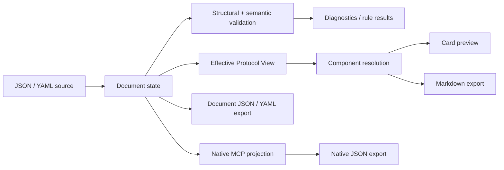

# MCP Toolkit: Editor

A web-based editor for [MCP Description](#the-mcp-description-mcpdesc-format) documents.

[](LICENSE)
[](CHANGELOG.md)
[](https://www.typescriptlang.org/)
[](https://mcpdesc.org)
[](https://mcpdesc.org)

## Version Support

> **Current: `main` / 2.x / MCP Description 0.8 + 0.9 RC.1 preview**
>
> Migration from 0.8 to 0.9 RC.1 is optional and executed after user confirmation.
>
> Documents authored for MCP Description 0.7 require confirmation to migrate
> one-way to 0.8 when loaded in the editor.
> For native 0.7 support, use the latest 1.x release of the un-maintained
> [`v1/main` branch](https://github.com/cisco-open/mcptoolkit-editor/tree/v1/main).

- **Monaco Editor** — JSON Schema-driven autocomplete, inline squiggles, folding, and syntax highlighting for JSON and YAML
- **Real-time validation** — CSP-safe structural and semantic validation for MCP Description `0.8.0` and pinned `0.9.0-rc.1`, with rule-linked diagnostics and per-rule results
- **Reviewed RC migration** — core conversion with explicit blocker fixes and a JSON Patch report; RC schema declarations are always retained
- **Native MCP projection** — inspect and export tools, resources, resource templates, or prompts for one protocol revision
- **Cards preview** — collapsible server, transport, security, capability, and named example views, including protocol-scoped Effective Protocol Views
- **Click-to-navigate** — click any type bubble in the preview to jump to its source in the editor
- **Markdown export** — download Handlebars-rendered documentation
- **JSON ↔ YAML** — edit in either format; convert with one click
- **LocalStorage persistence** — edits survive page reloads
- **Pure client-side** — no backend required


## Quick Start

### Run locally

```bash
git clone https://github.com/cisco-open/mcptoolkit-editor.git
cd mcptoolkit-editor
npm install
npm run dev
```

Open **http://localhost:5173**. The editor loads the configured default example
unless a URL source or saved content takes precedence. Edits persist in local storage.

To launch the configured title-link demo directly, run:

```bash
npm run demo:editor
```

This opens **http://localhost:5173/demo/editor.html**.

### Configure the editor title

Source consumers can customize the toolbar title and optionally link it:

```tsx
<App options={{
  title: '{mcpdesc} Editor',
  titleUrl: 'https://mcpdesc.org',
  titleUrlTarget: '_blank',
  titleLinkAppearance: 'plain',
}} />
```

The target defaults to `_self`; use `_blank` to open a new tab. Link appearance
defaults to `plain`, matching the unlinked title, or can be `standard` for a
conventional underlined link. Prebuilt `-dist` hosts can configure the same
options with root-element attributes; see the
[`@cisco_open/mcptoolkit-editor-dist` README](packages/mcptoolkit-editor-dist/README.md#configure-the-editor-title).

### Try the bundled examples

Use **Examples** in the toolbar to load bundled feature and vendor documents,
including Basic, Streamable HTTP, multi-transport, multi-version, reusable
components, and full-featured servers. Selection updates the editor and preview.

Link directly to a bundled example with its configured ID:

```text
http://localhost:5173/?example=full-featured
```

The URL example takes precedence over content saved in local storage.

### Load your own document

Use **Import** in the toolbar to load a `.json` or `.yaml` file from disk or a
public HTTPS URL. Remote servers must allow browser CORS requests. Imports are
limited to 1 MiB. You can also paste content directly into the editor; its
format is auto-detected.

To import a public document automatically, pass its encoded URL in the query
string:

```text
http://localhost:5173/?url=https%3A%2F%2Fexample.com%2Fserver.mcpdesc.yaml
```

### Validate and preview

- The **Validation panel** has one table at a time: errors, otherwise warnings,
  otherwise rule results. Diagnostic tables have sortable Path, Message, Rule
  Identifier, and Protocol columns, with search and protocol filters. Paths
  navigate to the source; full messages and producer codes remain available in
  tooltips. Parser locations include line and column when reported. The compact
  header explicitly labels the active **Selector**.
- The **card preview** renders a structured, interactive view — click any type badge to jump to its definition in the editor.
- Expand the disclosure beside the validation status to inspect rule results.
  Status checkboxes default to **Passed** only, support multiple selections, and
  disable statuses with no results. Click **Rule Identifier**, **Rule Title**,
  **Protocol**, or **Status** to toggle ascending/descending sorting. RC.1 rule
  titles come from the pinned published catalog, and rows link to their versioned
  documentation on mcpdesc.org. `not-applicable` and `not-evaluated` remain
  distinct statuses, never passes.
- Expanded tables reserve a five-row viewport by default, even with fewer
  results. Drag the horizontal separator to resize, or focus it and use the
  arrow keys; double-click resets the default. The text-size controls decrease,
  reset, or increase the panel font. Long cells truncate with full-text tooltips.

Diagnostics follow the common fields in the
[MCP Description validation result schema](https://mcpdesc.org/schema/validation-result/1.3.0.json):
rule identity, severity, and path, plus optional messages, producer codes, and
protocol versions. The editor normalizes paths into clickable JSON pointers;
parser diagnostics need not identify a rule.

### Migrate to 0.9 RC.1

Open a valid 0.8 document and choose **Migrate to 0.9 RC.1**. Review the
diagnostics and proposed patch before choosing **Apply migration**. Blocked
conversions leave the source unchanged. Only explicitly selected fixes remove
properties or move custom client requirements into `experimental`; ambiguous
URIs, malformed templates, and fractional integer values require source edits.
Metadata is never moved into `_meta` or `x-*` automatically.

Migration preserves JSON or YAML format and field ordering, and always emits:

```yaml
$schema: https://mcpdesc.org/schema/mcp-description/0.9.0-rc.1.json
mcpdesc: 0.9.0
```

RC.1 is not the final 0.9 release. Schema-declaration removal will only be
considered when final 0.9 support is added. Existing 0.8 examples remain valid
and can be used to try conversion.

### Export

Open **Export** and choose **YAML**, **JSON**, or **Markdown** to download the
document as `.mcpdesc.yaml`, `.mcpdesc.json`, or `.md`.

For 0.9 documents, **Export > Native MCP** offers tools, resources, resource
templates, and prompts. Choose a protocol revision and either all declarations
or an individual entry, review any diagnostics or the optional JSON preview,
then download. A single applicable revision is selected automatically; multiple
revisions require a choice unless the card preview already selects one. Export
selection does not change the preview's protocol selection. Capabilities remain
unavailable until core supports native capability projection.

Download icons beside section headings and individual entries open the same
native export dialog with the collection or entry preselected. Collections
produce arrays; individual declarations produce objects. Projection failures
disable download rather than substituting source data. Source documents are
never modified by export.

Native filenames include the server, collection or entry, and protocol revision:

```text
chess-coach.mcp.tools.2025-11-25.json
chess-coach.mcp.tool.analyze_game.2025-11-25.json
```

Identifiers, including resource URIs, are sanitized for filenames.


## The MCP Description (`mcpdesc`) format

An **MCP Description** (`mcpdesc`) is a portable, machine-readable contract that
declares everything an MCP server offers — tools, resources, prompts, transports,
and security — much like OpenAPI does for REST APIs.

This editor lets you author, validate, and preview mcpdesc documents. To generate
one from a live MCP server, use [`mcpcontract dump`](https://github.com/cisco-open/mcptoolkit-contract):

```bash
mcpcontract dump \
  --transport streamable-http \
  --url "https://your-mcp-server/mcp" \
  --output server.mcpdesc.json
```

> **Canonical source:** the MCP Description specification, versioned schemas, and
> full governance are published at [mcpdesc.org](https://mcpdesc.org).

## Build and deploy

```bash
npm run build   # outputs to dist/
npm run preview # local preview of the production build
```

The editor is pure client-side — deploy the `dist/` folder to any static host (GitHub Pages, Netlify, Vercel, S3, …). No backend required.

## Distribution

For hosting without building the editor, install the prebuilt bundle:

```bash
npm install @cisco_open/mcptoolkit-editor-dist
```

Serve its packaged `dist/` directory with your static host or existing web
server. It contains the application assets, not a backend or a React component
API. See the [editor-dist guide](packages/mcptoolkit-editor-dist/README.md)
for host integration and root-element configuration.

The separate viewer package embeds just the card view rather than the editor;
see [Embeddable MCP Description Card View](#embeddable-mcp-description-card-view).

## Architecture

Document processing runs in the browser. Validation, conversion, rendering, and
native projection do not require a backend. URL imports and external document
assets may still require network access.



The application separates four responsibilities:

- **Source and state:** React owns the editor text, parsed document, saved
  content, and selected protocol revision. Parsing and validation follow edits
  after a 300ms debounce. Migration review is explicit; previewing and exporting
  do not change authored source.
- **Document operations:** `@mcpdesc/core` supplies parsing, conversion,
  projection, and reference resolution. `@mcpdesc/validator/browser` supplies
  structural and semantic validation through the browser-compatible adapter in
  [src/core](src/core/). Local schemas and rule-title metadata support offline
  completion and readable results. A separate legacy validator gates 0.7 inputs.
- **Presentation:** Monaco displays the source; the editor and standalone viewer
  share the card-rendering component. Protocol filtering happens before local
  component references are resolved. Editor-only navigation and export actions
  are supplied through optional viewer callbacks.
- **Output:** JSON/YAML document exports retain authored component references.
  Markdown renders the resolved view through Handlebars. Native export asks core
  for protocol-specific MCP values and refuses to download a failed projection.

Monaco assets and workers are self-hosted. Active validation uses precompiled
browser-safe code, avoiding runtime code generation under strict Content
Security Policy. The deployment defaults are in [public/_headers](public/_headers).

For file ownership, change recipes, generated assets, and verification commands,
see the [agent/developer guide](AGENTS.md).

### Tech Stack

| Layer | Choice |
|-------|--------|
| Framework | React 18 + TypeScript |
| Build | Vite |
| Editor | Monaco Editor (`@monaco-editor/react`) |
| Document operations | `@mcpdesc/core` |
| Validation | `@mcpdesc/validator/browser` |
| Markdown | Handlebars 4 |
| YAML | yaml 2 |
| Styling | Tailwind CSS 4 |

## Embeddable MCP Description Card View

[`@cisco_open/mcptoolkit-viewer`](packages/mcptoolkit-viewer/) is a lightweight,
embeddable card-view component — think Swagger UI for MCP — published separately
to npm. Use it to render MCP Description documents in any web page or React app.

**Via `<script>` tag** (no build step required):

```html
<link rel="stylesheet" href="https://unpkg.com/@cisco_open/mcptoolkit-viewer/dist/mcptoolkit-viewer.css">
<div id="mcpdesc"></div>
<script src="https://unpkg.com/@cisco_open/mcptoolkit-viewer/dist/mcptoolkit-viewer.js"></script>
<script>
  McpToolkitViewer({
    dom_id: '#mcpdesc',
    url: '/path/to/server.mcpdesc.json'
  });
</script>
```

**Via React component:**

```tsx
import { McpDescCardView } from '@cisco_open/mcptoolkit-viewer/react';
import '@cisco_open/mcptoolkit-viewer/dist/mcptoolkit-viewer.css';

function MyPage({ doc, validation }) {
  return (
    <div className="mcptoolkit-viewer-root">
      <McpDescCardView doc={doc} validation={validation} />
    </div>
  );
}
```

For the full API reference, options, and theming details see [`packages/mcptoolkit-viewer/README.md`](packages/mcptoolkit-viewer/README.md).

## Contributing

See [CONTRIBUTING.md](CONTRIBUTING.md) for PR and DCO requirements, and
[AGENTS.md](AGENTS.md) for implementation boundaries and checks. Packaging,
version alignment, and tag-driven publication are covered in the
[maintainer distribution guide](docs/maintainers/distribution.md).

## License

This software is licensed under the Apache License 2.0. See [LICENSE](LICENSE) for details.


