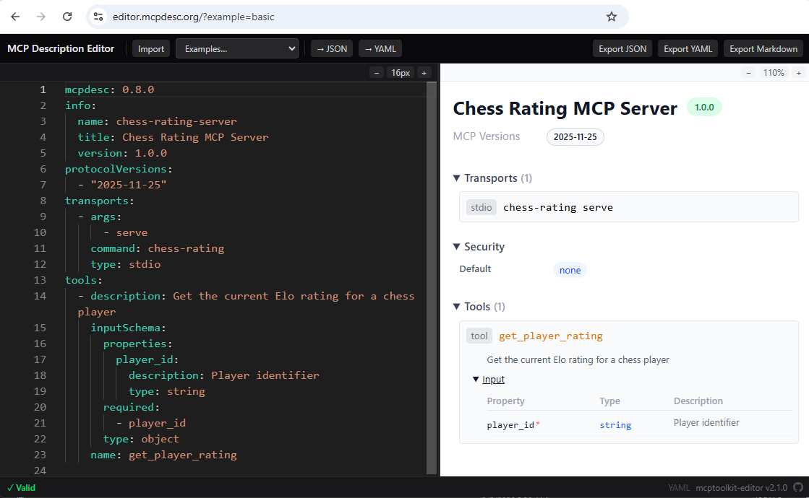

# MCP Toolkit: Editor

A web-based editor for [MCP Description](#the-mcp-description-mcpdesc-format) documents.

[](LICENSE)
[](CHANGELOG.md)
[](https://www.typescriptlang.org/)
[](https://mcpdesc.org)

## Version Support

> **Current: `main` / 2.x / MCP Description 0.8 + 0.9 RC.1 preview**
>
> Documents authored for MCP Description 0.7 require confirmation to migrate
> one-way to 0.8 when opened. Migration from 0.8 to 0.9 RC.1 is optional and
> explicitly reviewed. For native 0.7 support, use the maintained
> [`v1/main` branch](https://github.com/cisco-open/mcptoolkit-editor/tree/v1/main)
> and the latest 1.x release.

- **Monaco Editor** — JSON Schema-driven autocomplete, inline squiggles, folding, and syntax highlighting for JSON and YAML
- **Real-time validation** — CSP-safe structural and semantic validation for MCP Description `0.8.0` and pinned `0.9.0-rc.1`, with rule-linked diagnostics and per-rule results
- **Reviewed RC migration** — core conversion with explicit blocker fixes and a JSON Patch report; RC schema declarations are always retained
- **Native MCP projection** — inspect and export tools, resources, resource templates, or prompts for one protocol revision
- **Cards preview** — collapsible server, transport, security, capability, and named example views, including protocol-scoped Effective Protocol Views
- **Click-to-navigate** — click any type bubble in the preview to jump to its source in the editor
- **Markdown preview** — Handlebars-rendered documentation, ready to copy-paste or export
- **JSON ↔ YAML** — edit in either format; convert with one click
- **LocalStorage persistence** — edits survive page reloads
- **Pure client-side** — no backend required




## Quick Start

### Run locally

```bash
git clone https://github.com/cisco-open/mcptoolkit-editor.git
cd mcptoolkit-editor
npm install
npm run dev
```

Open **http://localhost:5173**. The editor loads the bundled Minimal example;
your edits persist in local storage.

To launch the configured title-link demo directly, run:

```bash
npm run demo:editor
```

This opens **http://localhost:5173/demo/editor.html**.

### Configure the editor title

Source consumers can customize the toolbar title and optionally link it:

```tsx
<App options={{
  title: '{mcpdesc} Editor',
  titleUrl: 'https://mcpdesc.org',
  titleUrlTarget: '_blank',
  titleLinkAppearance: 'plain',
}} />
```

The target defaults to `_self`; use `_blank` to open a new tab. Link appearance
defaults to `plain`, matching the unlinked title, or can be `standard` for a
conventional underlined link. Prebuilt `-dist` hosts can configure the same
options with root-element attributes; see the
[`@cisco_open/mcptoolkit-editor-dist` README](packages/mcptoolkit-editor-dist/README.md#configure-the-editor-title).

### Try the bundled examples

Click **Examples** in the toolbar to load a pre-built MCP Description, including
Minimal, Streamable HTTP, STDIO, multi-transport, multi-version, and
full-featured servers. Each example updates the preview instantly.

Link directly to a bundled example with its configured ID:

```text
http://localhost:5173/?example=full-featured
```

The URL example takes precedence over content saved in local storage.

### Load your own document

Use **Import** in the toolbar to load a `.json` or `.yaml` file from disk or a
public HTTPS URL. Remote servers must allow browser CORS requests. Imports are
limited to 1 MiB. You can also paste content directly into the editor; its
format is auto-detected.

To import a public document automatically, pass its encoded URL in the query
string:

```text
http://localhost:5173/?url=https%3A%2F%2Fexample.com%2Fserver.mcpdesc.yaml
```

### Validate and preview

- The **Validation panel** at the bottom shows errors in a dedicated diagnostic
  strip. Warnings appear there only when no errors remain; paths navigate to the
  source. The compact header explicitly labels the active **Selector**.
- The **card preview** renders a structured, interactive view — click any type badge to jump to its definition in the editor.
- Expand the disclosure beside the validation status to inspect rule results.
  Status checkboxes default to **Passed** only, support multiple selections, and
  disable statuses with no results. Click **Rule Identifier**, **Protocol**, or
  **Status** to toggle ascending/descending sorting. RC.1 rule rows link to their
  versioned documentation on mcpdesc.org. `not-applicable` and `not-evaluated`
  remain distinct statuses, never passes.

### Migrate to 0.9 RC.1

Open a valid 0.8 document and choose **Migrate to 0.9 RC.1**. Review the
diagnostics and proposed patch before choosing **Apply migration**. Blocked
conversions leave the source unchanged. Only explicitly selected fixes remove
properties or move custom client requirements into `experimental`; ambiguous
URIs, malformed templates, and fractional integer values require source edits.
Metadata is never moved into `_meta` or `x-*` automatically.

Migration preserves JSON or YAML format and field ordering, and always emits:

```yaml
$schema: https://mcpdesc.org/schema/mcp-description/0.9.0-rc.1.json
mcpdesc: 0.9.0
```

RC.1 is not the final 0.9 release. Schema-declaration removal will only be
considered when final 0.9 support is added. Existing 0.8 examples remain valid
and can be used to try conversion. The editor vendors the pinned RC completion
schema; maintainers can refresh it with `npm run sync:rc-schema`, which verifies
the installed validator's schema hash and identifier before copying it.

### Export

Open **Export** and choose **YAML**, **JSON**, or **Markdown** to download the
document as `.mcpdesc.yaml`, `.mcpdesc.json`, or `.md`.

For 0.9 documents, **Export > Native MCP** offers tools, resources, resource
templates, and prompts. Choose a protocol revision and either all declarations
or an individual entry, review any diagnostics or the optional JSON preview,
then download. A single applicable revision is selected automatically; multiple
revisions require a choice unless the card preview already selects one. Export
selection does not change the preview's protocol selection. Capabilities remain
unavailable until core supports native capability projection.

Download icons beside section headings and individual entries open the same
native export dialog with the collection or entry preselected. Collections
produce arrays; individual declarations produce objects. Projection failures
disable download rather than substituting source data. Source documents are
never modified by export.

Native filenames include the server, collection or entry, and protocol revision:

```text
chess-coach.mcp.tools.2025-11-25.json
chess-coach.mcp.tool.analyze_game.2025-11-25.json
```

Identifiers, including resource URIs, are sanitized for filenames.


## The MCP Description (`mcpdesc`) format

An **MCP Description** (`mcpdesc`) is a portable, machine-readable contract that
declares everything an MCP server offers — tools, resources, prompts, transports,
and security — much like OpenAPI does for REST APIs.

This editor lets you author, validate, and preview mcpdesc documents. To generate
one from a live MCP server, use [`mcpcontract dump`](https://github.com/cisco-open/mcptoolkit-contract):

```bash
mcpcontract dump \
  --transport streamable-http \
  --url "https://your-mcp-server/mcp" \
  --output server.mcpdesc.json
```

> **Canonical source:** the MCP Description specification, versioned schemas, and
> full governance are published at [mcpdesc.org](https://mcpdesc.org).
> This editor supports stable **`0.8.0`** and preview **`0.9.0-rc.1`** rules.
> Valid `0.7.0` documents can be migrated one-way to stable 0.8, then explicitly
> converted to 0.9 RC.1; earlier versions are unsupported.

## Build and deploy

```bash
npm run build   # outputs to dist/
npm run preview # local preview of the production build
```

The editor is pure client-side — deploy the `dist/` folder to any static host (GitHub Pages, Netlify, Vercel, S3, …). No backend required.

## Project Structure

```
src/
  core/                        # Reusable library (browser-compatible, no React)
    types.ts                   # MCP Description TypeScript types
    validator.ts               # CSP-safe 0.8 adapter; legacy 0.7 validation for migration
    validator.generated.js     # Legacy 0.7 validator used only to gate automatic migration
    renderer.ts                # Handlebars markdown renderer
    template.ts                # Markdown Handlebars template
    mcpdesc-schema.json        # MCP Description JSON Schema
    index.ts                   # Public API barrel
  components/
    Editor.tsx                 # Monaco editor wrapper
    Toolbar.tsx                # Top toolbar (file, examples, format, export)
    SplitPane.tsx              # Resizable split-pane layout
    ValidationPanel.tsx        # Error/warning status bar
    preview/
      PreviewPanel.tsx         # Tab container (Cards | Markdown)
      CardView.tsx             # Structured interactive preview
      MarkdownView.tsx         # Handlebars-rendered markdown preview
  hooks/
    useDoc.tsx                 # Central state (React Context + useReducer)
  examples/
    index.ts                   # Bundled example documents
  App.tsx                      # Root layout
  main.tsx                     # Entry point
```

### Core Library (`src/core/`)

The core module has **no React or DOM dependencies**. It exports:

- `McpDescValidator` — validate documents through the CSP-safe 0.8 standalone validator
- `McpDescRenderer` — render an MCP Description document to markdown via Handlebars
- Full TypeScript type definitions for MCP Description

This module is adapted from [mcptoolkit-contract](https://github.com/cisco-open/mcptoolkit-contract) and designed to be extractable as a standalone core package.

> **CSP note:** the editor validates 0.8 with
> `@mcpdesc/validator/standalone`, which does not use runtime code generation.
> The committed generated validator remains only for validating legacy 0.7
> documents before automatic migration.

### Tech Stack

| Layer | Choice |
|-------|--------|
| Framework | React 18 + TypeScript |
| Build | Vite |
| Editor | Monaco Editor (`@monaco-editor/react`) |
| Validation | `@mcpdesc/validator/standalone` |
| Markdown | Handlebars 4 |
| YAML | yaml 2 |
| Styling | Tailwind CSS 4 |

## Embeddable MCP Description Card View

[`@cisco_open/mcptoolkit-viewer`](packages/mcptoolkit-viewer/) is a lightweight,
embeddable card-view component — think Swagger UI for MCP — published separately
to npm. Use it to render MCP Description documents in any web page or React app.

**Via `<script>` tag** (no build step required):

```html
<link rel="stylesheet" href="https://unpkg.com/@cisco_open/mcptoolkit-viewer/dist/mcptoolkit-viewer.css">
<div id="mcpdesc"></div>
<script src="https://unpkg.com/@cisco_open/mcptoolkit-viewer/dist/mcptoolkit-viewer.js"></script>
<script>
  McpToolkitViewer({
    dom_id: '#mcpdesc',
    url: '/path/to/server.mcpdesc.json'
  });
</script>
```

**Via React component:**

```tsx
import { McpDescCardView } from '@cisco_open/mcptoolkit-viewer/react';
import '@cisco_open/mcptoolkit-viewer/dist/mcptoolkit-viewer.css';

function MyPage({ doc, validation }) {
  return (
    <div className="mcptoolkit-viewer-root">
      <McpDescCardView doc={doc} validation={validation} />
    </div>
  );
}
```

For the full API reference, options, and theming details see [`packages/mcptoolkit-viewer/README.md`](packages/mcptoolkit-viewer/README.md).

### Publishing the viewer to npm

Publishing is tag-driven via [`.github/workflows/publish.yml`](.github/workflows/publish.yml):

1. Bump `version` in [`packages/mcptoolkit-viewer/package.json`](packages/mcptoolkit-viewer/package.json) and the `version` constant in `packages/mcptoolkit-viewer/src/index.tsx`.
2. Update both changelogs (see [`AGENTS.md`](AGENTS.md)).
3. Update the viewer lockfile metadata with `npm install`, then run the release
  gate and confirm it is green:

   ```bash
  npm run release:check
   ```

  The gate verifies editor release metadata, runs lint and all tests, packages
  editor-dist, and builds the viewer because viewer files changed.
4. Merge to `main`, then push a `viewer-v<version>` tag. The workflow builds the `mcptoolkit-viewer` workspace and runs `npm publish` with provenance. Pre-release versions (e.g. `-rc.N`) publish under the `next` dist-tag; stable versions under `latest`.

> Release tags: the primary `@cisco_open/mcptoolkit-editor-dist` bundle uses the **default bare `v<version>`** tag; the viewer uses `viewer-v<version>`. See [`docs/maintainers/distribution.md`](docs/maintainers/distribution.md#tag--version-convention).

## License

This software is licensed under the Apache License 2.0. See [LICENSE](LICENSE) for details.


